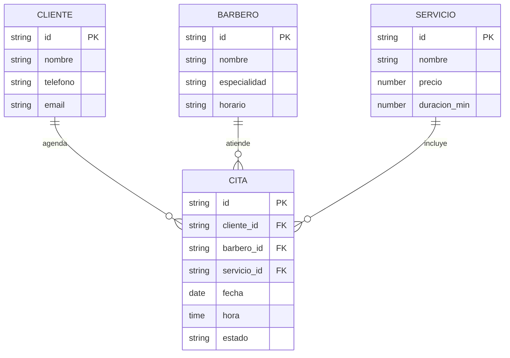
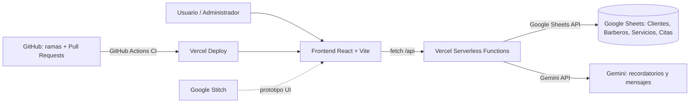
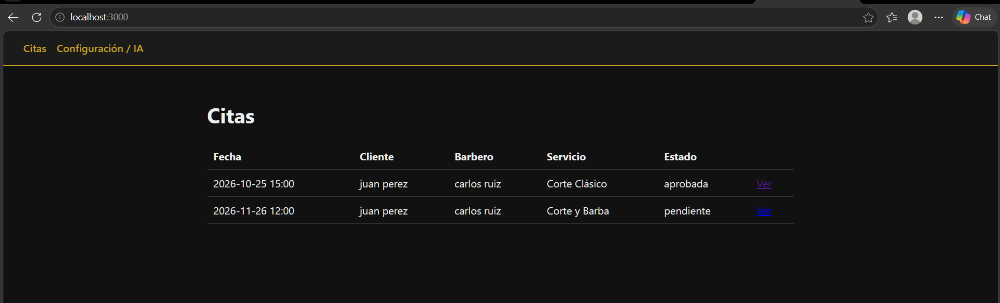

# 💈 web-design-barberia-citas

> Sistema web para gestionar las citas de una barbería: agenda, clientes, barberos y servicios en un solo lugar.

## 1. Elevator Pitch

Muchas barberías agendan por WhatsApp o en un cuaderno: se cruzan horarios, los clientes olvidan sus citas y no hay control de qué barbero atiende qué servicio. **BarberCitas** centraliza la agenda en una app web sencilla: el administrador registra y consulta citas, y un asistente con IA genera recordatorios y mensajes para los clientes, todo con datos en Google Sheets (sin servidor de base de datos que mantener).

## 2. Stack y herramientas TIC

| Capa | Tecnología |
|---|---|
| Frontend | React + Vite + React Router (JavaScript) |
| Backend ligero | Vercel Serverless Functions (`/api`) |

| # | Herramienta TIC | Uso en el proyecto | Justificación |
|---|---|---|---|
| 1 | **Google Sheets API** | Base de datos de las 4 entidades | Gratis, visible para el dueño de la barbería, sin montar BD |
| 2 | **Gemini API** | Genera recordatorios y mensajes para clientes | Automatiza comunicación y demuestra IA aplicada |
| 3 | **Vercel + GitHub Actions** | Despliegue continuo y CI en cada PR | Automatiza build/deploy y protege `main` |
| ➕ | **Google Stitch** | Prototipado UI/UX de las 3 vistas | Requisito de la rúbrica |

## 3. Entidades / Recursos (4)

`Clientes`, `Barberos`, `Servicios`, `Citas`.

## 4. Diagrama ER



## 5. Diagrama de Arquitectura



## 6. Vistas y flujo de usuario

| Vista | Ruta | Endpoints que la alimentan |
|---|---|---|
| Dashboard / Lista de citas | `/` | `GET /api/citas` |
| Detalle de cita | `/citas/:id` | `GET /api/citas?id=:id` |
| Configuración / Asistente IA | `/configuracion` | `POST /api/gemini`, `GET /api/citas?recurso=clientes\|barberos\|servicios` |

**Flujo:** el usuario entra al Dashboard → selecciona una cita → ve el detalle → desde Configuración genera con Gemini un mensaje de recordatorio para el cliente.

## 7. Prototipo (Google Stitch)

- 🔗 Enlace al proyecto en Stitch: _pendiente_
- Capturas: `docs/stitch-dashboard.png`, `docs/stitch-detalle.png`, `docs/stitch-config.png` _(pendiente)_

## 8. Proyecto funcionando

 _(pendiente)_

## 9. Video de presentación

🎥 _Enlace pendiente (máx. 5 min)_. Guion en [`docs/GUION_VIDEO.md`](docs/GUION_VIDEO.md).

## 10. Estructura de carpetas

```
web-design-barberia-citas/
├── .github/workflows/ci.yml   # CI: build en cada PR
├── api/                       # Funciones serverless (Sheets y Gemini)
│   ├── citas.js
│   └── gemini.js
├── docs/                      # Git flow, guion, capturas
├── src/
│   ├── pages/                 # Dashboard, CitaDetalle, Configuracion
│   ├── services/api.js        # Cliente HTTP del frontend
│   ├── App.jsx
│   └── main.jsx
├── .env.example
└── README.md
```

## 11. Instalación y ejecución

```bash
git clone https://github.com/<usuario>/web-design-barberia-citas.git
cd web-design-barberia-citas
npm install
cp .env.example .env     # completar claves (nunca subir .env)
npm run dev              # frontend
# Para probar /api en local: npx vercel dev
```

**Preparar Google Sheets:** crear un libro con las hojas `Clientes`, `Barberos`, `Servicios` y `Citas` (encabezados en la fila 1, igual a los campos del ER), crear una cuenta de servicio en Google Cloud y compartir el libro con su correo.

## 12. GitHub Flow

Ver [`docs/GIT_FLOW.md`](docs/GIT_FLOW.md): ramas `feature/*`, Pull Requests obligatorios y merge a `main` tras revisión.

## 13. Equipo

| Integrante | Rol |
|---|---|
| _Nombre_ (líder) | Repositorio y arquitectura |
| _Nombre_ | UI/UX y Stitch |
| _Nombre_ | API Sheets + Gemini |
| _Nombre_ | Documentación y video |
