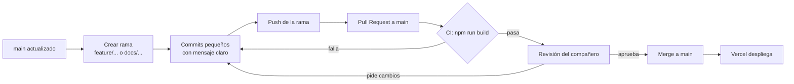

# GitHub Flow del equipo

Así trabajamos el repositorio. La regla principal: **nadie sube cambios directo a `main`**. Todo entra por una rama y un Pull Request revisado por el compañero.

## El flujo, paso a paso



1. **Partir de `main` actualizado**

   ```bash
   git checkout main
   git pull
   ```

2. **Crear una rama por cada funcionalidad o hito**

   ```bash
   git checkout -b feature/nombre-corto
   ```

3. **Hacer commits pequeños**, cada uno con un solo cambio.
4. **Subir la rama** y abrir el **Pull Request** hacia `main`, explicando qué agrega.

   ```bash
   git push -u origin feature/nombre-corto
   ```

5. **GitHub Actions** corre el build (`.github/workflows/ci.yml`). Si falla, se corrige en la misma rama.
6. **El otro integrante revisa** el PR: lo aprueba o pide cambios.
7. Con la aprobación se hace **merge a `main`**, y **Vercel** publica la nueva versión.

## Nombres de las ramas

| Prefijo | Para qué | Ejemplo |
|---|---|---|
| `feature/` | Código nuevo de la app | `feature/esqueleto-inicial` |
| `docs/` | Documentación, diagramas o capturas | `docs/equipo-y-git-flow` |
| `fix/` | Corregir un error | `fix/fecha-citas` |

## Mensajes de commit

Empiezan con el tipo de cambio y dicen **qué** se hizo:

| Tipo | Cuándo | Ejemplo |
|---|---|---|
| `feat:` | Funcionalidad nueva | `feat: agregar estructura inicial de la aplicacion de barberia` |
| `docs:` | README, diagramas o capturas | `docs: agregar capturas de las 3 vistas diseñadas en Google Stitch` |
| `fix:` | Corrección de un error | `fix: corregir el formato de la hora en el dashboard` |

## Historial de Pull Requests

| PR | Rama | Qué agregó | Autor | Revisó |
|---|---|---|---|---|
| #1 | `feature/esqueleto-inicial` | Proyecto React + Vite, las 3 vistas, funciones `/api` para Sheets y Gemini, CI y configuración de Vercel | Davier | — (merge de Davier) |
| #2 | `feature/prototipo-stitch` | Prototipo de las 3 vistas en Google Stitch (enlace y capturas en el README) | Manuela | Davier |
| #3 | `docs/equipo-y-git-flow` | Este documento y el equipo en el README | Manuela | Davier |

## Cuidado con las claves

- Las claves reales (Gemini y la cuenta de servicio de Google) van **solo** en el archivo `.env`, que está en el `.gitignore`.
- En el repositorio solo está `.env.example`, con valores de ejemplo.
- En Vercel las claves se configuran como **variables de entorno** del proyecto.
